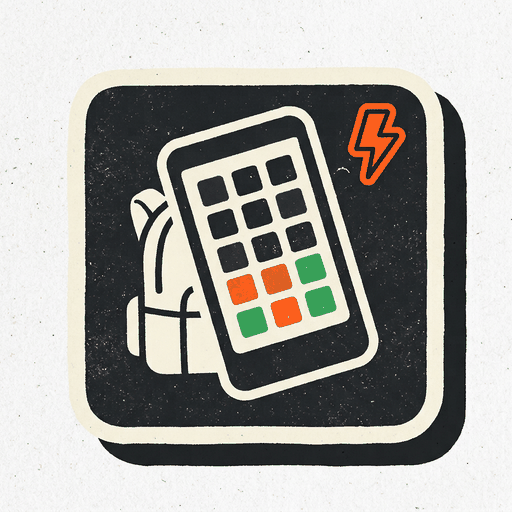
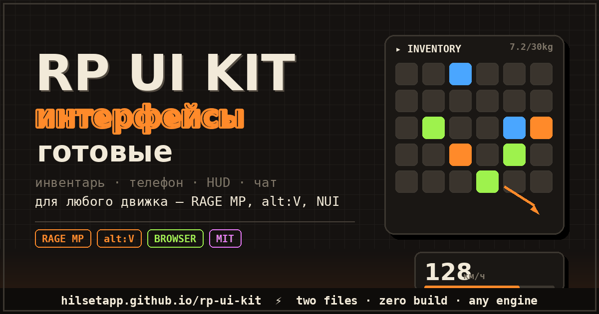

<div align="center">



# RP UI Kit

**Готовые веб-интерфейсы для GTA RP серверов.Любой движок: RAGE MP,alt:V,NUI - или обычный браузер.**

[](https://hilsetapp.github.io/rp-ui-kit/)
[](LICENSE)

[🌍 English version → README.en.md](README.en.md)



</div>

---

## Что это?

Каждый RP-сервер переписывает одно и то же: инвентарь, телефон, спидометр, чат.
Это недели UI-возни вместо того, чтобы делать *свою* фишку.

**RP UI Kit** - открытая библиотека готовых, вылизанных интерфейсов в **двух файлах**:
без фреймворков,без сборки,без `node_modules`. Закинь в CEF-папку, подключи события - работает.

### Что внутри v0.2

| Компонент | Что получаешь |
|---|---|
| 🎒 **Инвентарь** | сетка с настоящим drag-and-drop (работает в старом CEF!), счётчики, вес, меню «использовать/выбросить» по правому клику |
| 🚗 **HUD** | спидометр с автопередачами, шкала топлива с тревогой, лампы ремня и двигателя, табличка улицы |
| 💬 **Чат** | теги сообщений, цветные теги (админ/систем), авто-затухание, поле ввода |
| 📱 **Телефон** | чёлка → домашний экран → рабочие приложения: СМС-диалоги, банковский перевод, заметки (сохраняются), настройки темы + твои собственные приложения |

### Агностик движка по замыслу

Один `RPUI.bridge` сам узнаёт, где исполняется:

| Где | Исходящие события | Входящие события |
|---|---|---|
| **RAGE MP** | `mp.trigger("rpui:*", json)` | `browser.call("RPUI.receive", json)` |
| **alt:V** | `alt.emit("rpui:*", data)` | `webView.emit("RPUI.receive", …)` |
| **браузер** | консоль + JS-подписчики | `RPUI.receive(ev, data)` |

Одна страница: разрабатываешь **в браузере** с демо-режимом и логом событий,
а в игру уносишь **без единой правки**.

## 🚀 Поиграться: песочница

> **https://hilsetapp.github.io/Gtarp-ui-kit/**

Интерактив: тягай предметы, газуй по спидометру, открой телефон — и смотри вживую
поток событий, которые получит твой сервер.

## Быстрый старт (4 шага)

```bash
# 1. скопируй файлы
kit/rp-ui-kit.js  +  kit/rp-ui-kit.css  →  твоя CEF-папка
```

```html
<!-- 2. подключи -->
<link rel="stylesheet" href="rp-ui-kit.css">
<script src="rp-ui-kit.js"></script>
```

```js
// 3. создай
const hud = RPUI.HUD();
document.body.appendChild(hud.el);
RPUI.on("hud:update", (d) => hud.update(d));
```

```js
// 4. клиентская часть RAGE MP
browser.call("RPUI.receive", JSON.stringify({ ev: "hud:update", data: { speed: 88, fuel: 54 } }));
```

## Тема — одной строкой

```css
:root { --rpui-accent: #4da6ff; } /* все компоненты подхватят */
```

## Скины — три вида на компонент (v0.2.0)

У каждого компонента есть встроенные стили-пресеты, переключаются одной опцией `skin`:

| Компонент | Скины |
|---|---|
| 🎒 Инвентарь | `panel` (дефолт) · `tight` · `huge` |
| 🚗 HUD | `cluster` (дефолт) · `naked` · `pro` (+RPM-шкала) |
| 💬 Чат | `stream` (дефолт) · `bubble` · `console` |
| 📱 Телефон | `onyx` (дефолт) · `arctic` · `bubblegum` |

```js
RPUI.Inventory({ skin: "huge", ... });
```

Пощёлкай все в песочнице — чипы скинов прямо над кнопками демо.

Шрифты, фон, радиусы, цвета тревоги — тоже переменные: шапка файла `rp-ui-kit.css`.

## Шпаргалка по API

| Фабрика | Эмитит события | Методы |
|---|---|---|
| `RPUI.Inventory({columns, rows, items, maxWeight})` | `inventory:use · :move · :drop · :close` | `setItems(l)` `updateItem(slot, item?)` `close()` `show()` |
| `RPUI.HUD()` | — | `update({speed,gear,fuel,belt,engine,street})` |
| `RPUI.Chat({fadeMs, input, max})` | `chat:send` | `push({tag,nick,text,cls})` `clear()` |
| `RPUI.Phone({balance, apps})` | `phone:close · :sms · :transfer · :app` | `open()` `close()` `setBalance(n)` |

Полное описание событий и подключение к **RedAge** — в
[GUIDE_RU.md (для новичков, шаг за шагом)](GUIDE_RU.md).

## Планы

- 🧍 Экран регистрации/лобби (v0.2)
- 🗺 Рамка миникарты + зоновые алерты (v0.2)
- 🧾 Тосты-уведомления (v0.2)
- Чего не хватает именно тебе? [Пиши в Issues](https://github.com/hilsetapp/rp-ui-kit/issues) или присылай PR — [CONTRIBUTING.md](CONTRIBUTING.md).

## Лицензия

MIT-делай что хочешь, сохрани уведомление. [LICENSE](LICENSE).

---

<div align="center">
Сделано для RU RP-сцены · работает там, куда Lua не приходит · 2026
</div>
